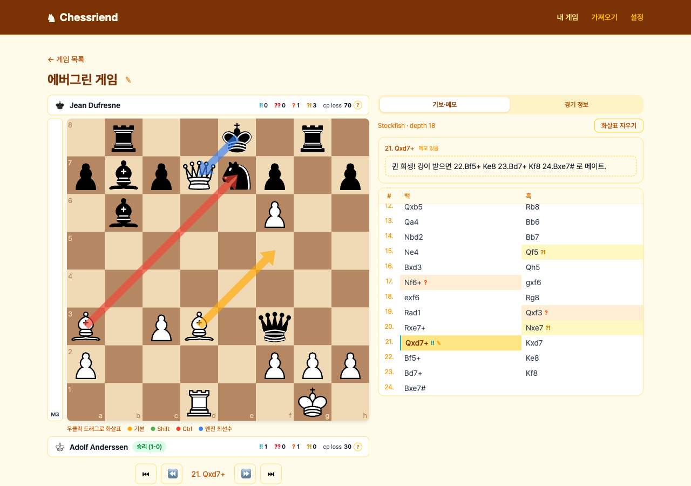
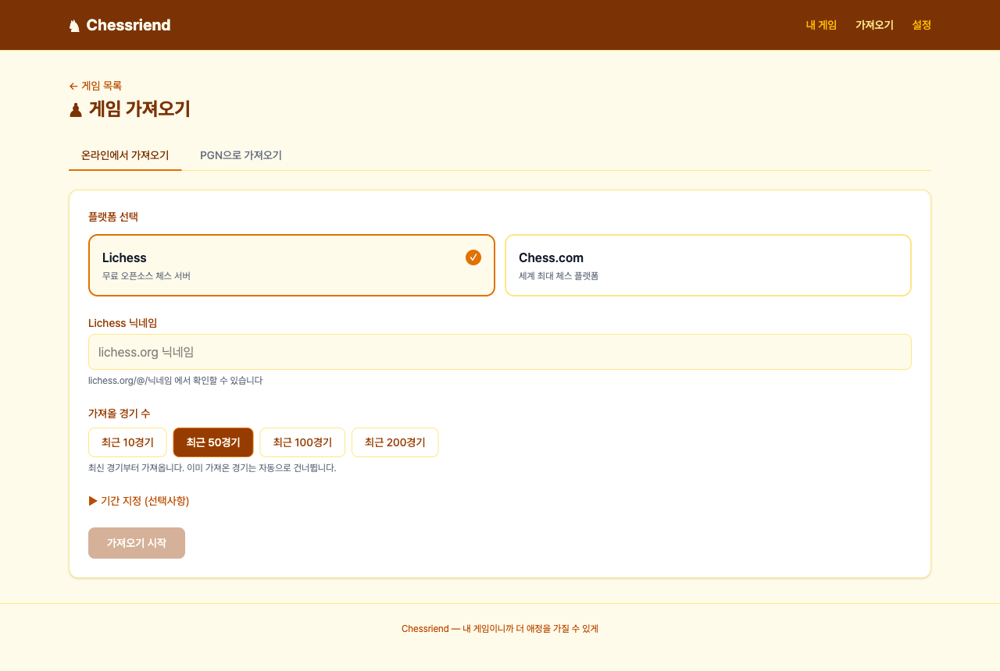
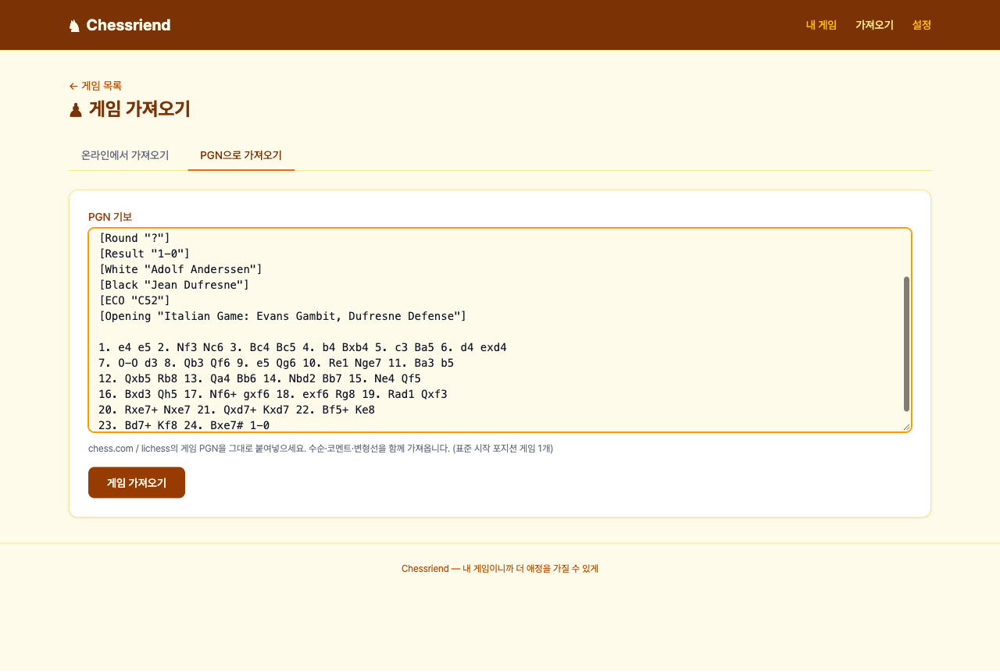
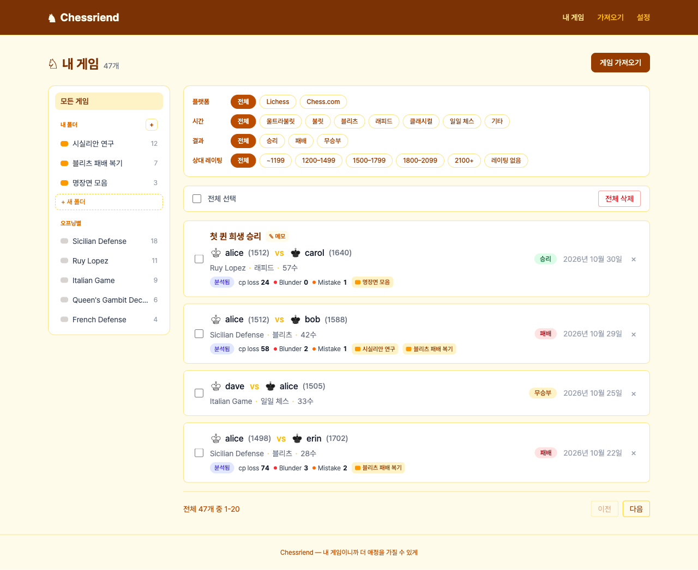
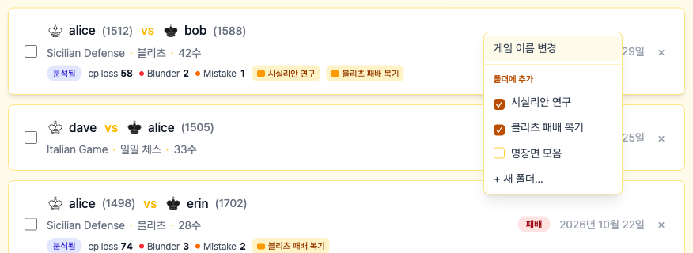
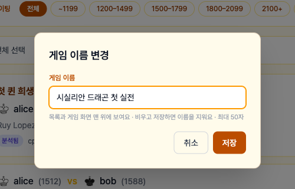
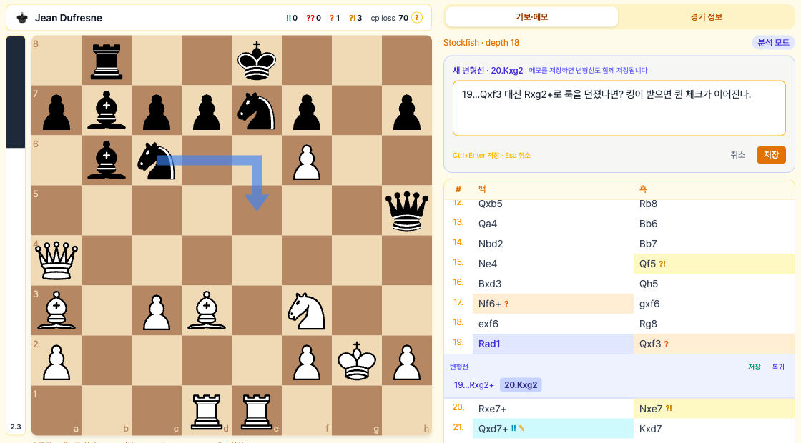
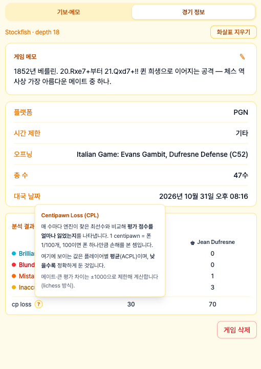
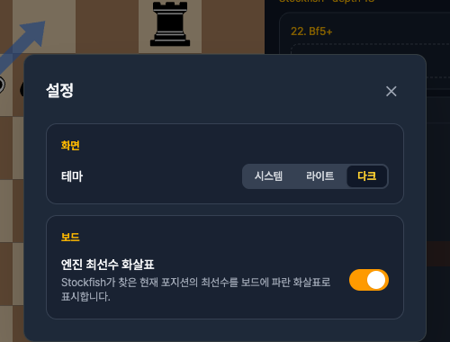
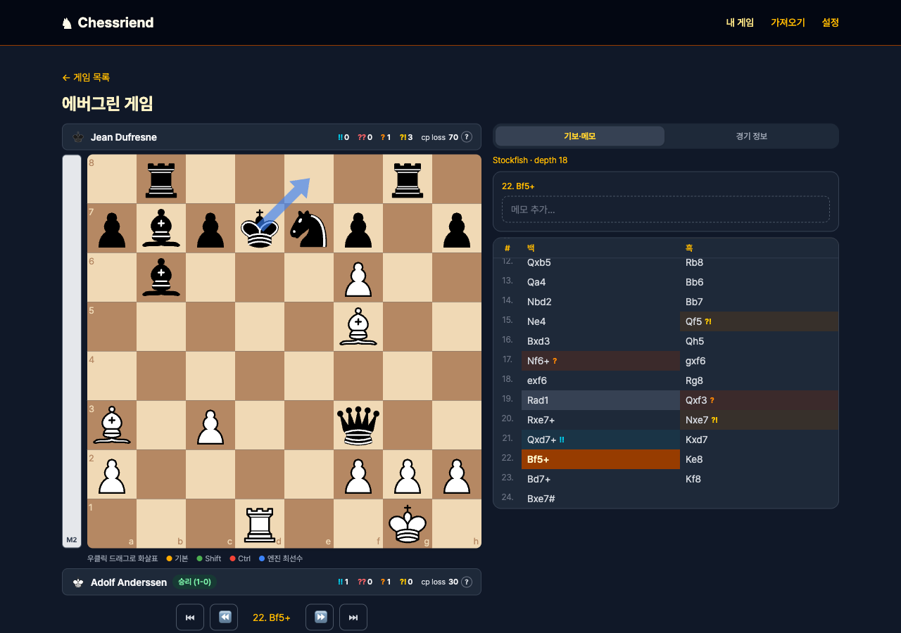

# Chessriend ♞

**내가 둔 체스 게임을 가져와 엔진으로 분석하고, 생각을 남기며 복기하는 앱.**

Lichess · Chess.com에서 둔 게임이나 PGN으로 된 고전 명국을 불러와, 한 수 한 수 다시 짚어 보고 메모와 화살표로 그때의 생각을 기록할 수 있습니다.
"내 게임이니까 더 애정을 가질 수 있게" — 엔진 점수를 보는 데서 끝나지 않고, **내 게임을 내 언어로 정리해 두는 것**이 목표입니다.



> 개발·실행·API 등 기술 문서는 [`src/README.md`](src/README.md)에 있습니다.
> 화면의 게임 목록은 가상의 데모 데이터, 복기 화면은 1852년 *Evergreen Game*(Anderssen vs Dufresne)입니다.

---

## 사용 가이드

### 1단계 — 게임 가져오기

상단 메뉴 **가져오기**로 이동합니다.

**온라인에서 가져오기**: 플랫폼(Lichess / Chess.com)을 고르고 닉네임을 입력한 뒤 **가져오기 시작**.
최근 10 / 50 / 100 / 200경기 중에서 고르거나, **기간 지정**으로 원하는 연·월의 게임만 가져올 수 있습니다. 이미 가져온 게임은 자동으로 건너뛰고, 진행 상황이 실시간으로 보여요.



**PGN으로 가져오기**: 대회 기보나 고전 명국을 PGN 그대로 붙여넣습니다. PGN 안의 코멘트와 변형선도 함께 들어옵니다.



<details>
<summary>PGN의 시간 정보는 이렇게 읽어요</summary>

| `TimeControl` 태그 | 뜻 | 분류 |
|---|---|---|
| `600+5` | 10분 + 수당 5초 | 기본 시간 + 40×증분으로 불릿·블리츠·래피드·클래시컬 판정 |
| `180` | 3분 (증분 없음) | 블리츠 |
| `40/7200:3600` | 40수 2시간, 이후 1시간 (구간제) | 첫 구간 기준 → 클래시컬 |
| `1/259200` | 한 수에 3일 | **일일 체스** |
| `-`, `?`, 없음 | 시간 정보 없음 | **기타** |

`Event` 태그에 *Daily* / *Correspondence*가 들어 있으면 일일 체스로 봅니다.
</details>

### 2단계 — 게임 목록에서 정리하기

상단 메뉴 **내 게임**. 왼쪽 메뉴로 범위를 고르고, 위쪽 필터로 좁혀 봅니다.



- **분석 요약**: 분석을 마친 게임에는 `분석됨`과 함께 **내 평균 cp loss · Blunder · Mistake 수**가 나옵니다.
- **필터**: 플랫폼 · 시간(울트라불릿 ~ 클래시컬, 일일 체스, 기타) · 결과(**내 기준** 승리·패배·무승부) · **상대 레이팅**(~1199 ~ 2100+, 레이팅 없음). 필터를 걸면 오른쪽 위에 **필터 초기화**가 생겨요.
- **왼쪽 메뉴**
  - **내 폴더**: "시실리안 연구", "블리츠 패배 복기"처럼 직접 폴더를 만듭니다(`+` 또는 `+ 새 폴더`). 폴더 이름 옆 `⋯`(또는 우클릭)으로 이름 변경·삭제. 폴더를 지워도 게임은 남아요.
  - **오프닝별**: 같은 오프닝으로 둔 게임을 자동으로 묶어 줍니다. 어떤 오프닝에서 자주 무너지는지 보기 좋아요.

**게임을 우클릭**하면 메뉴가 열립니다.



- **게임 이름 변경**: "첫 퀸 희생 승리"처럼 기억하기 쉬운 이름을 붙입니다. 목록과 게임 화면 맨 위에 크게 보여요. 비우고 저장하면 이름이 지워집니다.

  

- **폴더에 추가**: 체크하면 넣고, 다시 누르면 뺍니다. 한 게임을 여러 폴더에 넣을 수 있어요. `+ 새 폴더…`로 만들면서 바로 넣을 수도 있습니다.
- 여러 게임을 체크한 뒤 목록 위 **폴더에 추가**로 한 번에 넣을 수도 있어요.

### 3단계 — 분석하고 복기하기

게임을 누르면 복기 화면이 열립니다. 처음에는 오른쪽 위 **게임 분석**을 눌러 주세요. Stockfish(깊이 18)가 모든 수를 평가하고 분류하며, 결과는 저장되어 다시 계산하지 않습니다. 수별 메모와 변형선은 분석 후에 쓸 수 있어요.


- **대국자 바** (보드 위·아래): 결과와 함께 각 대국자의 `!!` `??` `?` `?!` 개수, 평균 cp loss. 내가 흑이면 보드도 흑 시점입니다.
- **보드**
  - 기물을 누르면 **둘 수 있는 칸**이 점으로 표시되고, 클릭 또는 드래그로 둡니다.
  - 왼쪽 **평가 막대**와 Stockfish 실시간 평가.
  - 키보드: `←` `→` 한 수씩 · `↑` 처음 · `↓` 끝 · `Esc` 변형선 나가기
- **기보**: 수 옆의 기보 기호(`!!` `??` `?` `?!`)와 색으로 좋은 수·실수를 한눈에 봅니다.
- **화살표로 생각 남기기**: 보드에서 **우클릭 드래그** — 기본 주황 · `Shift` 초록 · `Ctrl/⌘` 빨강. 포지션마다 저장돼서 다음에 열어도 그대로 있어요. 같은 화살표를 다시 그리면 지워집니다.
- **엔진 최선수 화살표**: 설정에서 켜면 Stockfish의 최선수가 **파란 화살표**로 보입니다(기본: 꺼짐 — 먼저 스스로 생각해 보세요).

#### "이렇게 뒀다면?" — 변형선

기보와 **다른 수**를 두면 변형선이 시작되고, 엔진이 바로 평가합니다. 기보와 같은 수를 두면 그냥 기보를 따라 진행해요.



- 변형선에 메모를 저장하면 변형선도 함께 저장됩니다. 저장한 변형선은 나중에 이어서 둘 수 있어요.
- 수 번호가 함께 표시됩니다 (`19...Rxg2+`, `20.Kxg2`).
- 필요 없는 변형선은 **우클릭 → 변형선 삭제**.

### 4단계 — 기록 남기기

- **수별 메모**: 기보에서 수를 고르면 오른쪽에 메모 칸이 열립니다 (`Ctrl+Enter` 저장 · `Esc` 취소).
- **게임 메모 · 경기 정보**: 오른쪽 **경기 정보** 탭에서 게임 전체에 대한 메모를 남기고, 플랫폼·시간·오프닝과 분석 결과 표를 볼 수 있습니다. `cp loss` 옆 `?`에 마우스를 올리면 설명이 나와요.



### 설정

상단 메뉴 **설정**은 창으로 열려서, 복기 중에도 보던 수를 잃지 않고 바꿀 수 있습니다.

- **화면 테마**: 시스템 / 라이트 / 다크
- **엔진 최선수 화살표**: 켜기 / 끄기

| 설정 창 | 다크 모드 |
|---|---|
|  |  |

---

## 분석 결과 읽는 법

### 수 분류와 기보 기호

평가 점수(센티폰)를 **기대 승률(Win%)**로 바꿔, 그 수를 둔 뒤 승률이 얼마나 떨어졌는지로 판정합니다 (lichess와 같은 방식). 이미 크게 이기고 있거나 지고 있을 때는 점수 차이가 커도 승률 변화가 작아서, 점수만으로 판단하는 것보다 실제 체감에 가깝습니다.

| 기호 | 분류 | 기준 |
|:---:|------|------|
| `!!` | **Brilliant** (훌륭한 수) | 기물을 희생에 놓았는데도(더 싼 기물에게 방어 없이 노출) 승률 손실이 2%p 미만 |
| `?!` | **Inaccuracy** (부정확) | 승률 10%p 이상 손실 |
| `?` | **Mistake** (실수) | 승률 20%p 이상 손실 |
| `??` | **Blunder** (큰 실수) | 승률 30%p 이상 손실 |

체크메이트로 게임을 끝낸 수는 항상 최선수로 봅니다.

### cp loss (평균 센티폰 손실)

- **센티폰(centipawn)** = 폰 1/100개. 100이면 폰 하나만큼의 손해입니다.
- **cp loss**는 매 수마다 엔진의 최선수와 비교해 평가가 얼마나 떨어졌는지를 **평균**낸 값입니다 (ACPL). **낮을수록 정확하게 둔 것**입니다.
- 메이트처럼 극단적인 평가는 ±1000으로 제한해 계산합니다 (lichess 방식) — 한 수 때문에 평균이 폭주하지 않도록.
- 예: *Evergreen Game*(1852)에서 이긴 Anderssen은 30, 진 Dufresne은 70.

---

## 체스 용어

| 용어 | 뜻 |
|------|----|
| **PGN** | Portable Game Notation — 체스 기보를 적는 표준 텍스트 형식. 대국자·결과·시간 같은 태그와 수순, 코멘트, 변형선을 담습니다 |
| **FEN** | Forsyth–Edwards Notation — 한 순간의 보드 상태를 한 줄로 적는 형식 |
| **변형선 (Variation)** | 실제 기보와 다른 "만약 이렇게 뒀다면"의 수순 |
| **평가 (Evaluation)** | 엔진이 판단한 포지션의 유불리. `+1.5`는 백이 폰 1.5개만큼 유리, `M3`은 3수 안에 메이트 |
| **일일 체스 (Daily / Correspondence)** | 한 수에 하루~며칠씩 생각할 수 있는 장기 대국 |
| **ECO** | 오프닝 분류 코드 (예: `C52` Evans Gambit) |

---

## 시작하기

Docker, Stockfish, JDK 25, pnpm이 필요합니다.

```bash
docker compose up -d postgres                                # DB
./gradlew flywayMigrate generateJooq && ./gradlew bootRun    # 백엔드  → http://localhost:8081
cd frontend && pnpm install && pnpm dev                      # 프론트   → http://localhost:5173
```

브라우저에서 http://localhost:5173 을 열고 [1단계](#1단계--게임-가져오기)부터 따라 해 보세요.
자세한 설정, 테스트, API는 [`src/README.md`](src/README.md)를 보세요.

---

## 문서

| 문서 | 내용 |
|------|------|
| [`src/README.md`](src/README.md) | 기술 스택, 아키텍처, 실행·빌드·테스트, 환경 설정, REST API |
| [`frontend/README.md`](frontend/README.md) | 프론트엔드 구조 |
| [`docs/architecture.md`](docs/architecture.md) | 설계 배경 |
| [`docs/`](docs/) | 기능별 작업 내역 |
