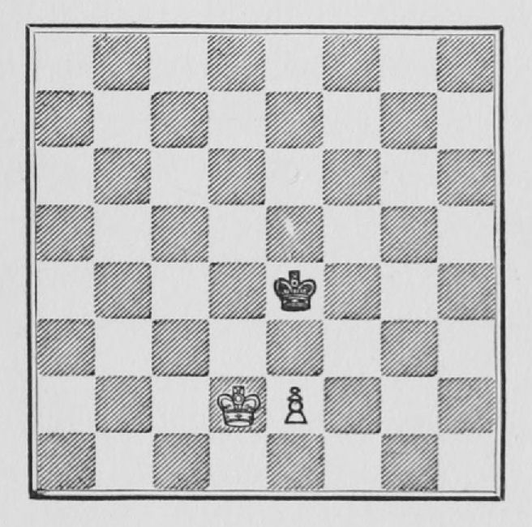
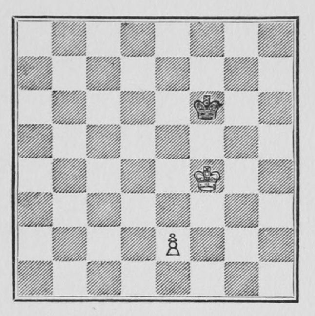

# C01 · 폰 승격과 왕의 지원

- 원저: José Raúl Capablanca, *Chess Fundamentals* (1921), Part I
- 범위: 원서 9–13쪽
- 언어: 영어
- 수집일: 2026-10-31
- 출처: [원문](https://www.gutenberg.org/files/33870/33870-h/33870-h.htm#page9)
- 권리 근거와 판본 설명: [출처 목록](../sources.md)

이 파일은 고전 영문 본문 발췌이며 한국어 번역본이 아닙니다. 원문 기보와 수순을 보존하고 줄바꿈·표·도해 경로를 Markdown에 맞게 바꾸었습니다. 원문 쪽수 표시는 생략했습니다. 수표의 `|`는 원문 열 구분입니다. 원저의 일반화나 분석을 현대 엔진으로 전수 검증한 자료는 아닙니다.

## 원문 배포 고지

This eBook is for the use of anyone anywhere in the United States and most other parts of the world at no cost and with almost no restrictions whatsoever. You may copy it, give it away or re-use it under the terms of the [Project Gutenberg License](../licenses/project-gutenberg.md) included with this eBook or online at [www.gutenberg.org](https://www.gutenberg.org). If you are not located in the United States, you’ll have to check the laws of the country where you are located before using this ebook.

## 영문 발췌

## 2. PAWN PROMOTION

The gain of a Pawn is the smallest material advantage that can be obtained in a game; and it often is sufficient to win, even when the Pawn is the only remaining unit, apart from the Kings. It is essential, speaking generally, that

*the King should be in front of his Pawn, with at least one intervening square*.

If the opposing King is directly in front of the Pawn, then the game cannot be won. This can best be explained by the following examples.

**Example 5.**

The position is drawn, and the way to proceed is for Black to keep the King always directly in front of the Pawn, and when it cannot be done, as for instance in this position because of the White King, then the Black King must be kept in front of the White King. The play would proceed thus: 1 P - K 3, K - K 4; 2 K - Q 3, K - Q 4. This is a very important move. Any other move would lose, as will be shown later. As the Black King cannot be kept close up to the Pawn, it must be brought as far forward as possible and, at the same time, in front of the White King.

3 P - K 4 ch, K - K 4; 4 K - K 3, K - K 3; 5 K - B 4, K - B 3. Again the same case. As the White King comes up, the Black King must be kept in front of it, since it cannot be brought up to the Pawn.

6 P - K 5 ch, K - K 3; 7 K - K 4, K - K 2; 8 K - Q 5, K - Q 2; 9 P - K 6 ch, K - K 2; 10 K - K 5, K - K 1; 11 K - Q 6, K - Q 1. If now White advances the Pawn, the Black King gets in front of it and White must either give up the Pawn or play K - K 6, and a stale mate results. If instead of advancing the Pawn White withdraws his King, Black brings his King up to the Pawn and, when forced to go back, he moves to K *in front* of the Pawn ready to come up again or to move in front of the White King, as before, should the latter advance.

The whole mode of procedure is very important and the student should become thoroughly conversant with its details; for it involves principles to be taken up later on, and because many a beginner has lost identical positions from lack of proper knowledge. At this stage of the book I cannot lay too much stress on its importance.

**Example 6.**—In this position White wins, as the King is in front of his Pawn and there is one intervening square.

The method to follow is to

*advance the King as far as is compatible with the safety of the Pawn and never to advance the Pawn until it is essential to its own safety*.

Thus:

1. K - K 4, K - K 3.

Black does not allow the White King to advance, therefore White is now compelled to advance his Pawn so as to force Black to move away. He is then able to advance his own King.

2. P - K3, K - B 3; 3. K - Q 5, K - K 2.

If Black had played 3...K - B 4, then White would be forced to advance the Pawn to K 4, since he could not advance his King without leaving Black the opportunity to play K - K 5, winning the Pawn. Since he has not done so, it is better for White not to advance the Pawn yet, since its own safety does not require it, but to try to bring the King still further forward. Thus:

4. K - K 5, K - Q 2; 5. K - B 6, K - K 1.

Now the White Pawn is too far back and it may be brought up within protection of the King.

6. P - K 4, K - Q 2.

Now it would not do to play K - B 7, because Black would play K - Q 3, and White would have to bring back his King to protect the Pawn. Therefore he must continue.

7. P - K 5, K - K 1.

Had he moved anywhere else, White could have played K - B 7, followed by the advance of the Pawn to K 6, K 7, K 8; all these squares being protected by the King. As Black tries to prevent that, White must now force him to move away, at the same time always keeping the King in front of the Pawn. Thus:

8. K - K 6.

P - K 6 would make it a draw, as Black would then play K - B, and we would have a position similar to the one explained in connection with Example 5.

8...K - B 1; 9. K - Q 7.

King moves and the White Pawn advances to K 8, becomes a Queen, and it is all over.

This ending is like the previous one, and for the same reasons should be thoroughly understood before proceeding any further.

---
