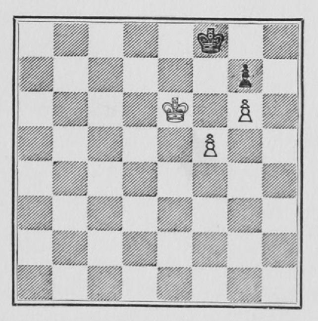
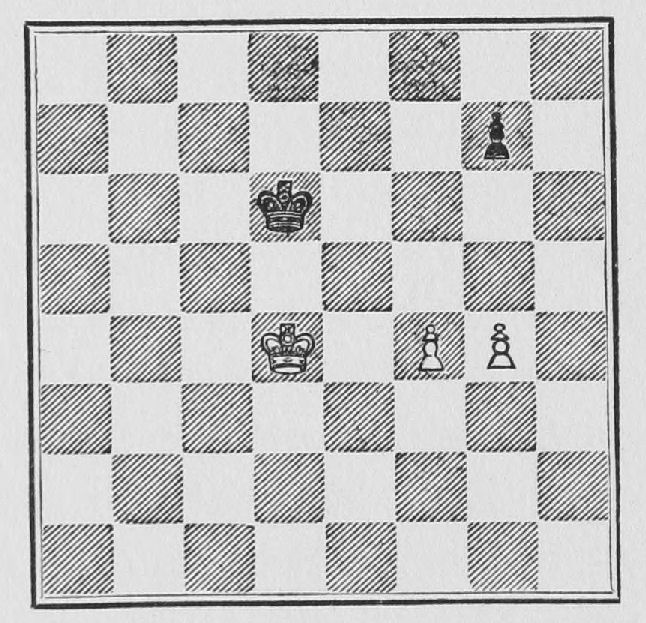
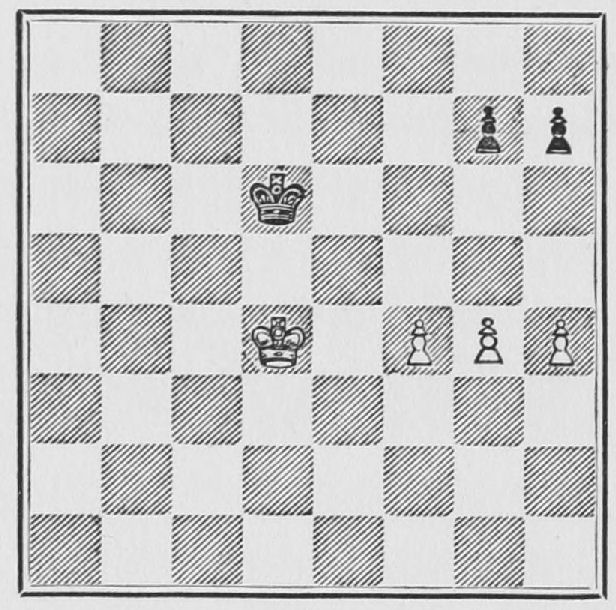
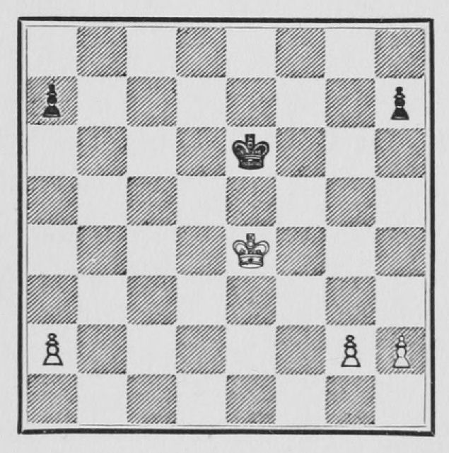

# C02 · 폰 다수와 양쪽 윙의 운영

- 원저: José Raúl Capablanca, *Chess Fundamentals* (1921), Part I
- 범위: 원서 13–19쪽
- 언어: 영어
- 수집일: 2026-10-31
- 출처: [원문](https://www.gutenberg.org/files/33870/33870-h/33870-h.htm#page13)
- 권리 근거와 판본 설명: [출처 목록](../sources.md)

이 파일은 고전 영문 본문 발췌이며 한국어 번역본이 아닙니다. 원문 기보와 수순을 보존하고 줄바꿈·표·도해 경로를 Markdown에 맞게 바꾸었습니다. 원문 쪽수 표시는 생략했습니다. 수표의 `|`는 원문 열 구분입니다. 원저의 일반화나 분석을 현대 엔진으로 전수 검증한 자료는 아닙니다.

## 원문 배포 고지

This eBook is for the use of anyone anywhere in the United States and most other parts of the world at no cost and with almost no restrictions whatsoever. You may copy it, give it away or re-use it under the terms of the [Project Gutenberg License](../licenses/project-gutenberg.md) included with this eBook or online at [www.gutenberg.org](https://www.gutenberg.org). If you are not located in the United States, you’ll have to check the laws of the country where you are located before using this ebook.

## 영문 발췌

## 3. PAWN ENDINGS

 

I shall now give a couple of simple endings of two Pawns against one, or three against two, that the reader may see how they can be won. Fewer explanations will be given, as it is up to the student to work things out for himself. Furthermore, nobody can learn how to play well merely from the study of a book; it can only serve as a guide and the rest must be done by the teacher, if the student has one; if not, the student must realise by long and bitter experience the practical application of the many things explained in the book.

 

**Example 7.**

 

[](https://www.gutenberg.org/files/33870/33870-h/images/Fig7.jpg)

 

 

In this position White cannot win by playing 1 P - B 6, because Black plays, not P × P, which would lose, but 1...K - Kt 1, and if then 2 P × P, K × P, and draws, as shown in a previous case. If 2 P - B 7 ch, K - B 1, and White will never be able to Queen his Pawn without losing it. If 2 K - K 7, P × P; 3 K × P, K - B 1, and draws. White, however, can win the position given in the diagram by playing:

 

1 K - Q 7, K - Kt 1; 2 K - K 7, K - R 1; 3 P - B 6, P × P. If 3...K - Kt 1; 4 P - B 7 ch, K - R 1; 5 P - B 8 (Q) mate.

 

4 K - B 7, P - B 4; 5 P - Kt 7 ch, K - R 2; 6 P - Kt 8 (Q) ch, K - R 3; 7 Q - Kt 6 mate.

 

[](https://www.gutenberg.org/files/33870/33870-h/images/Fig8.jpg)

 

**Example 8.**—In the above position White can't win by 1 P - B 5. Black's best answer would be P - Kt 3 draws. (The student should work this out.) He cannot win by 1 P - Kt 5, because P - Kt 3 draws. (This, because of the principle of the "*opposition*" which governs this ending as well as all the Pawn-endings already given, and which will be explained more fully later on.)

 

White can win, however, by playing: 1 K - K 4, K - K 3. (If 1...P - Kt 3; 2 K - Q 4, K - K 3; 3 K - B 5, K - B 3; 4 K - Q 6, K - B 2; 5 P - Kt 5, K - Kt 2; 6 K - K 7, K - Kt 1; 7 K - B 6, K - R 2; 8 K - B 7 and White wins the Pawn.)

 

2 P - B 5 ch, K - B 3; 3 K - B 4, P - Kt 3. (If this Pawn is kept back we arrive at the ending shown in Example 7.) 4 P - Kt 5 ch, K - B 2; 5 P - B 6, K - K 3; 6 K - K 4, K - B 2; 7 K - K 5, K - B 1. White cannot force his Bishop's Pawn into Q (find out why), but by giving his Pawn up he can win the other Pawn and the game. Thus:

 

8 P - B 7, K × P; 9 K - Q 6, K - B 1; 10 K - K 6, K - Kt 2; 11 K - K 7, K - Kt 1; 12 K - B 6, K - R 2; 13 K - B 7, K - R 1; 14 K × P , K - Kt 1.

 

There is still some resistance in Black's position. In fact, the only way to win is the one given here, as will easily be seen by experiment.

 

15 K - R 6 (if K - B 6, K - R 2; and in order to win White must get back to the actual position, as against 16 P - Kt 6 ch, K - R 1 draws), K - R 1; 16 P - Kt 6, K - Kt 1; 17 P - Kt 7, K - B 2; 18 K - R 7, and White queens the Pawn and wins.

 

This ending, apparently so simple, should show the student the enormous difficulties to be surmounted, even when there are hardly any pieces left, when playing against an adversary who knows how to use the resources at his disposal, and it should show the student, also, the necessity of paying strict attention to these elementary things which form the basis of true mastership in Chess.

 

**Example 9.**—In this ending

 

[](https://www.gutenberg.org/files/33870/33870-h/images/Fig9.jpg)

 

White can win by advancing any of the three Pawns on the first move, but it is convenient to follow the general rule, whenever there is no good reason against it, of *advancing the Pawn that has no Pawn opposing it*. Thus we begin by—

 

 

---

 

1. P - B 5, K - K 2.

 

If P - Kt 3, P - B 6; and we have a similar ending to one of those shown above. If 1...P - R 3; 2 P - Kt 5.

 

2. K - K 5, K - B 2; 3. P - Kt 5, K - K 2.

 

 

If 3...P - Kt 3; 4 P - B 6, and if 3...P - R 3; 4 P - Kt 6 ch, and in either case we have a similar ending to one of those already shown.

 

4. P - R 5,

 

and by following it up with P - Kt 6 we have the same ending previously shown. Should Black play 4...P - Kt 3, then R P × P, P × P; P - B 6 ch with the same result.

 

Having now seen the cases when the Pawns are all on one side of the board we shall now examine a case when there are Pawns on both sides of the board.

 

**Example 10.**—In these cases the general rule is to *act immediately on the side where you have the superior forces*. Thus we have:

 

[](https://www.gutenberg.org/files/33870/33870-h/images/Fig10.jpg)

 

1. P - K Kt 4.

 

 

It is generally advisable to advance the Pawn that is free from opposition.

 

```text
 | 1. ........ | P - Q R 4.
```

 

Black makes an advance on the other side, and now White considers whether or not he should stop the advance. In this case either way wins, but generally the advance should be stopped when the opposing King is far away.

 

2. P - Q R 4, K - B 3; 3. P - R 4, K - K 3.

 

If 3...K - Kt 3, then simple counting will show that White goes to the other side with his King, wins the P at Q R 4, and then Queens his single Pawn long before Black can do the same.

 

4. P - Kt 5, K - B 2; 5. K - B 5, K - Kt 2; 6. P - R 5, K - B 2.

 

If 6...P - R 3; 7 P - Kt 6, and then the two Pawns defend themselves and White can go to the other side with his King, to win the other Pawn.

 

7. K - K 5.

 

Now it is time to go to the other side with the King, win the Black Pawn and Queen the single Pawn. This is typical of all such endings and should be worked out by the student in this case and in similar cases which he can put up.

 

 

---
