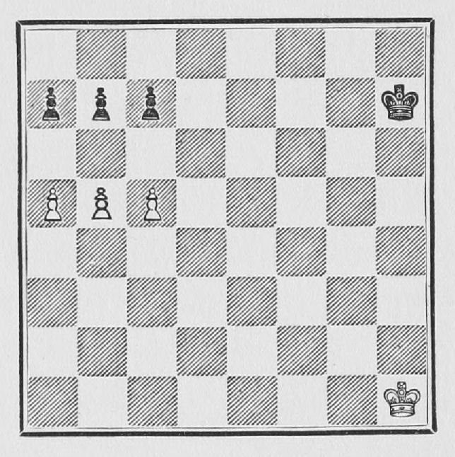

# C03 · 희생을 이용한 패스드 폰 돌파

- 원저: José Raúl Capablanca, *Chess Fundamentals* (1921), Part I
- 범위: 원서 40–41쪽
- 언어: 영어
- 수집일: 2026-10-31
- 출처: [원문](https://www.gutenberg.org/files/33870/33870-h/33870-h.htm#page40)
- 권리 근거와 판본 설명: [출처 목록](../sources.md)

이 파일은 고전 영문 본문 발췌이며 한국어 번역본이 아닙니다. 원문 기보와 수순을 보존하고 줄바꿈·표·도해 경로를 Markdown에 맞게 바꾸었습니다. 원문 쪽수 표시는 생략했습니다. 수표의 `|`는 원문 열 구분입니다. 원저의 일반화나 분석을 현대 엔진으로 전수 검증한 자료는 아닙니다.

## 원문 배포 고지

This eBook is for the use of anyone anywhere in the United States and most other parts of the world at no cost and with almost no restrictions whatsoever. You may copy it, give it away or re-use it under the terms of the [Project Gutenberg License](../licenses/project-gutenberg.md) included with this eBook or online at [www.gutenberg.org](https://www.gutenberg.org). If you are not located in the United States, you’ll have to check the laws of the country where you are located before using this ebook.

## 영문 발췌

## 11. OBTAINING A PASSED PAWN

When three or more Pawns are opposed to each other in some such position as the one in Example 24, there is always a chance for one side or the other of obtaining a passed Pawn.

[](https://www.gutenberg.org/files/33870/33870-h/images/Fig25.jpg)

**Example 24.**—In the above position the way of obtaining a passed Pawn is to advance the centre Pawn.

```text
 | 1. P - Kt 6 | R P × P
If B P × P; P - R 6,
 | 2. P - B 6 | P × B P
 | 3. P - R 6 |
```

and as in this case the White Pawn is nearer to Queen than any of the Black Pawns, White will win. Now if it had been Black's move Black could play

```text
 | 1. ........ | P - Kt 3
 | 2. B P × P | B P × P
```

It would not be advisable to try to obtain a passed Pawn because the White Pawns would be nearer to Queen than the single Black Pawn.

```text
 | 3. P × P | P × P
```

and the game properly played would be a draw. The student should work this out for himself.

---
