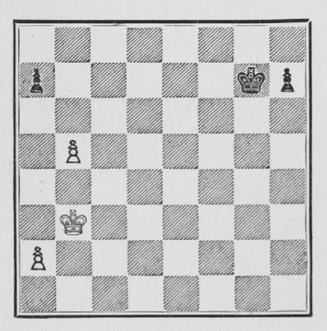

# C04 · 승격 경주의 수 계산

- 원저: José Raúl Capablanca, *Chess Fundamentals* (1921), Part I
- 범위: 원서 41–43쪽
- 언어: 영어
- 수집일: 2026-10-31
- 출처: [원문](https://www.gutenberg.org/files/33870/33870-h/33870-h.htm#page41)
- 권리 근거와 판본 설명: [출처 목록](../sources.md)

이 파일은 고전 영문 본문 발췌이며 한국어 번역본이 아닙니다. 원문 기보와 수순을 보존하고 줄바꿈·표·도해 경로를 Markdown에 맞게 바꾸었습니다. 원문 쪽수 표시는 생략했습니다. 수표의 `|`는 원문 열 구분입니다. 원저의 일반화나 분석을 현대 엔진으로 전수 검증한 자료는 아닙니다.

## 원문 배포 고지

This eBook is for the use of anyone anywhere in the United States and most other parts of the world at no cost and with almost no restrictions whatsoever. You may copy it, give it away or re-use it under the terms of the [Project Gutenberg License](../licenses/project-gutenberg.md) included with this eBook or online at [www.gutenberg.org](https://www.gutenberg.org). If you are not located in the United States, you’ll have to check the laws of the country where you are located before using this ebook.

## 영문 발췌

## 12. HOW TO FIND OUT WHICH PAWN WILL BE FIRST TO QUEEN

When two Pawns are free, or will be free, to advance to Queen, you can find out, by counting, which Pawn will be the first to succeed.

**Example 25.**—In this position whoever moves first wins.

[](https://www.gutenberg.org/files/33870/33870-h/images/Fig26.jpg)

The first thing is to find out, by counting, whether the opposing King can be in time to stop the passed Pawn from Queening. When, as in this case, it cannot be done, the point is to count which Pawn comes in first. In this case the time is the same, but the Pawn that reaches the eighth square first and becomes a Queen is in a position to capture the adversary's Queen when he makes one. Thus:

```text
 | 1. P - R 4 | P - K R 4
 | 2. P - R 5 | P - R 5
 | 3. P - Kt 6 | P × P
```

Now comes a little calculation. White can capture the Pawn, but if he does so, he will not, when Queening, command the square where Black will also Queen his Pawn. Therefore, instead of taking, he plays:

```text
 | 4. P - R 6 | P - R 6
 | 5. P - R 7 | P - R 7
 | 6. P - R 8 (Q), and wins.
```

The student would do well to acquaint himself with various simple endings of this sort, so as to acquire the habit of counting, and thus be able to know with ease when he can or cannot get there first. Once again I must call attention to the fact that a book cannot by itself teach how to play. It can only serve as a guide, and the rest must be learned by experience, and if a teacher can be had at the same time, so much the faster will the student be able to learn.

---
