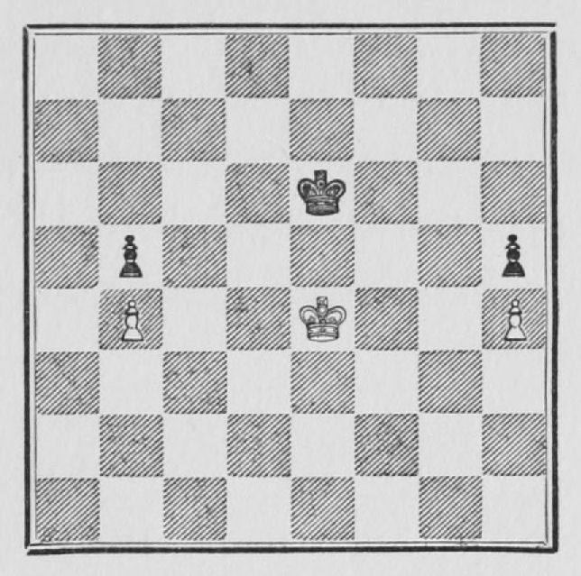
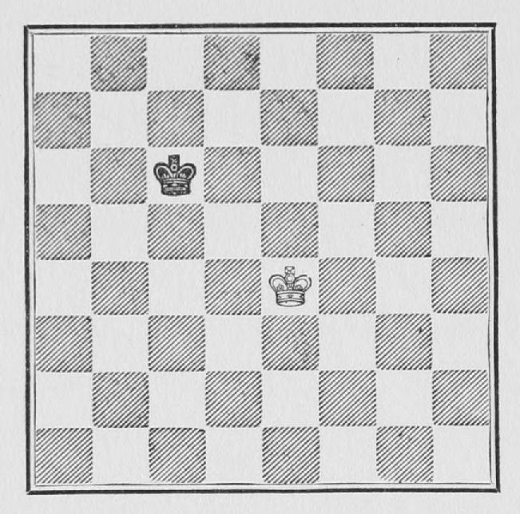
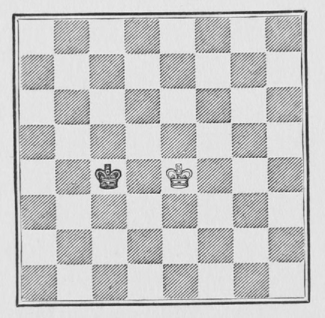
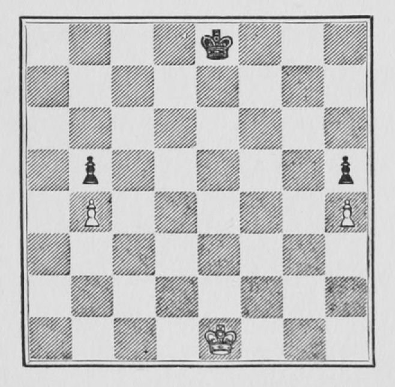
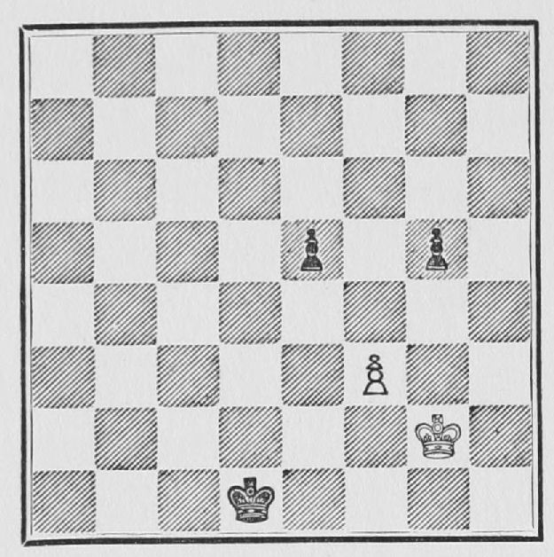

# C05 · 근거리·원거리 오포지션

- 원저: José Raúl Capablanca, *Chess Fundamentals* (1921), Part I
- 범위: 원서 43–50쪽
- 언어: 영어
- 수집일: 2026-10-31
- 출처: [원문](https://www.gutenberg.org/files/33870/33870-h/33870-h.htm#page43)
- 권리 근거와 판본 설명: [출처 목록](../sources.md)

이 파일은 고전 영문 본문 발췌이며 한국어 번역본이 아닙니다. 원문 기보와 수순을 보존하고 줄바꿈·표·도해 경로를 Markdown에 맞게 바꾸었습니다. 원문 쪽수 표시는 생략했습니다. 수표의 `|`는 원문 열 구분입니다. 원저의 일반화나 분석을 현대 엔진으로 전수 검증한 자료는 아닙니다.

## 원문 배포 고지

This eBook is for the use of anyone anywhere in the United States and most other parts of the world at no cost and with almost no restrictions whatsoever. You may copy it, give it away or re-use it under the terms of the [Project Gutenberg License](../licenses/project-gutenberg.md) included with this eBook or online at [www.gutenberg.org](https://www.gutenberg.org). If you are not located in the United States, you’ll have to check the laws of the country where you are located before using this ebook.

## 영문 발췌

## 13. THE OPPOSITION

When Kings have to be moved, and one player can, by force, bring his King into a position similar to the one shown in the following diagram, so that his adversary is forced to move and make way for him, the player obtaining that advantage is said to have *the opposition*.

[](https://www.gutenberg.org/files/33870/33870-h/images/Fig27.jpg)

**Example 26.**—Suppose in the above position White plays

```text
 | 1. K - Q 4 |
```

Now Black has the option of either opposing the passage of the White King by playing K - Q 3 or, if he prefers, he can *pass* with his own King by replying K - B 4. Notice that the Kings are directly opposed to each other, and the number of intervening squares between them is odd—one in this case.

The opposition can take the form shown above, which can be called actual or close frontal opposition; or this form:

[](https://www.gutenberg.org/files/33870/33870-h/images/Fig28.jpg)

which can be called actual or close diagonal opposition, or, again, this form:

[](https://www.gutenberg.org/files/33870/33870-h/images/Fig29.jpg)

which can be called actual or close lateral opposition.

In practice they are all one and the same. The Kings are always on squares of the same colour, there is only one intervening square between the Kings, and the player who has moved last "*has the opposition*."

Now, if the student will take the trouble of moving each King backwards as in a game in the same frontal, diagonal or lateral line respectively shown in the diagrams, we shall have what may be called *distant* frontal, diagonal and lateral opposition respectively.

The matter of the opposition is highly important, and takes at times somewhat complicated forms, all of which can be solved mathematically; but, for the present, the student should only consider the most simple forms. (An examination of some of the examples of King and Pawns endings already given will show several cases of close opposition.)

In all simple forms of opposition,

*when the Kings are on the same line and the number of intervening squares between them is even, the player who has the move has the opposition*.

[](https://www.gutenberg.org/files/33870/33870-h/images/Fig30.jpg)

**Example 27.**—The above position shows to advantage the enormous value of the opposition. The position is very simple. Very little is left on the board, and the position, to a beginner, probably looks absolutely even. It is not the case, however. *Whoever has the move wins.* Notice that the Kings are directly in front of one another, and that the number of intervening squares is *even*.

Now as to the procedure to win such a position. The proper way to begin is to move straight up. Thus:

```text
 | 1. K - K 2 | K - K 2
 | 2. K - K 3 | K - K 3
 | 3. K - K 4 | K - B 3
```

Now White can exercise the option of either playing K - Q 5 and thus passing with his King, or of playing K - B 4 and prevent the Black King from passing, thereby keeping the opposition. Mere counting will show that the former course will only lead to a draw, therefore White takes the latter course and plays:

```text
 | 4. K - B 4 | K - Kt 3
```

If 4...K - K 3; 5 K - Kt 5 will win.

```text
 | 5. K - K 5 | K - Kt 2
```

Now by counting it will be seen that White wins by capturing Black's Knight Pawn.

The process has been comparatively simple in the variation given above, but Black has other lines of defence more difficult to overcome. Let us begin anew.

```text
 | 1. K - K 2 | K - Q 1
```

Now if 2 K - Q 3, K - Q 2, or if 2 K - K 3, K - K 2, and Black obtains the opposition in both cases. (When the Kings are directly in front of one another, and the number of intervening squares between the Kings is *odd*, the player who has moved last has the opposition.)

Now in order to win, the White King must advance. There is only one other square where he can go, B 3, and that is the right place. Therefore it is seen that in such cases when the opponent makes a so-called waiting move, you must advance, leaving a rank or file free between the Kings. Therefore we have—

```text
 | 2. K - B 3 | K - K 2
```

Now, it would be bad to advance, because then Black, by bringing up his King in front of your King, would obtain the opposition. It is White's turn to play a similar move to Black's first move, viz.:

```text
 | 3. K - K 3 |
```

which brings the position back to the first variation shown. The student would do well to familiarise himself with the handling of the King in all examples of opposition. It often means the winning or losing of a game.

**Example 28.**—The following position is an excellent proof of the value of the opposition as a means of defence.

[](https://www.gutenberg.org/files/33870/33870-h/images/Fig31.jpg)

White is a Pawn behind and apparently lost, yet he can manage to draw as follows:

```text
 | 1. K - R 1 ! |
```

The position of the Pawns does not permit White to draw by means of the actual or close opposition, hence he takes the distant opposition: in effect if 1 K - B 1 (actual or close opposition), K - Q 7; 2 K - B 2, K - Q 6 and White cannot continue to keep the lateral opposition essential to his safety, because of his own Pawn at B 3. On the other hand, after the text move, if

```text
 | 1. ........ | K - Q 7
 | 2. K - R 2 | K - Q 6
 | 3. K - R 3 ! | K - K 7
{49} | 4. K - Kt 2 | K - K 6
 | 5. K - Kt 3 | K - Q 5
 | 6. K - Kt 4 |
```

attacking the Pawn and forcing Black to play 6... K - K 6 when he can go back to Kt 3 as already shown, and always keep the opposition.

Going back to the original position, if

```text
 | 1. K - R 1 | P - Kt 5
```

White does not play P × P, because P - K 5 will win, but plays:

```text
 | 2. K - Kt 2 | K - Q 7
```

If 2...P × P ch; 3 K × P, followed by K - K 4, will draw.

```text
 | 3. P × P | P - K 5
```

and mere counting will show that both sides Queen, drawing the game.

If the student will now take the trouble to go back to the examples of King and Pawns which I have given in this book,[[3]](https://www.gutenberg.org/files/33870/33870-h/33870-h.htm#Nt3) he will realise that in all of them the matter of the opposition is of paramount importance; as, in fact, it is in nearly all endings of King and Pawns, except in such cases where the Pawn-position in itself ensures the win.

---
