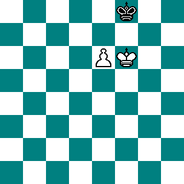
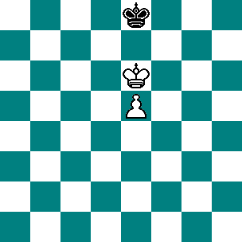
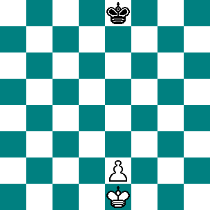
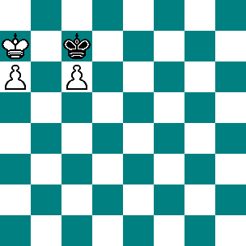
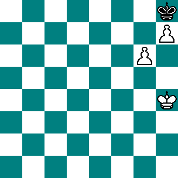

# S01 · 왕과 폰의 기본 승격 조건

- 원저: *The Blue Book of Chess*, The John C. Winston Company 개정판 (1910), Chapter VII; Staunton 등의 저술을 바탕으로 편집
- 범위: 원서 219–220, 도해 6–10쪽
- 언어: 영어
- 수집일: 2026-10-31
- 출처: [원문](https://www.gutenberg.org/files/16377/16377-h/16377-h.htm#Pg_219)
- 권리 근거와 판본 설명: [출처 목록](../sources.md)

이 파일은 고전 영문 본문 발췌이며 한국어 번역본이 아닙니다. 원문 기보와 수순을 보존하고 줄바꿈·표·도해 경로를 Markdown에 맞게 바꾸었습니다. 원문 쪽수 표시는 생략했습니다. 수표의 `|`는 원문 열 구분입니다. 원저의 일반화나 분석을 현대 엔진으로 전수 검증한 자료는 아닙니다.

편집 주: 절 제목에는 비숍·나이트가 등장하지만 이 발췌의 설명과 도해 6–10은 왕과 폰에 관한 부분입니다. “7단 체크 여부”, “연결 폰이면 항상 승리” 같은 문구를 임의의 포지션에 적용하지 마세요. 구체적인 왕의 위치와 스테일메이트 조건을 함께 확인해야 합니다.

## 원문 배포 고지

This eBook is for the use of anyone anywhere in the United States and most other parts of the world at no cost and with almost no restrictions whatsoever. You may copy it, give it away or re-use it under the terms of the [Project Gutenberg License](../licenses/project-gutenberg.md) included with this eBook or online at [www.gutenberg.org](https://www.gutenberg.org). If you are not located in the United States, you’ll have to check the laws of the country where you are located before using this ebook.

## 영문 발췌

## KING AND PAWN,—KING, BISHOP, AND PAWN,—AND KING, KNIGHT, AND PAWN,—AGAINST KING.

 

When one Pawn only is left on the board, supported by its King, and the adverse King is either in front of the Pawn, or within such distance as to be able to intercept it, it becomes a point of great nicety in some cases, to calculate whether or not you have the power of Queening the Pawn, and therefore of winning the game. This frequently depends upon your gaining the opposition, which you cannot always do.

 

In the next position (see Diagram 6) you have the opposition, and if Black have to play you will win. Thus:—

 

```text
 | 
 | 1. K. to his sq.
2. P. to K's 7th. | 2. K. to his 2d.
3. K. to B's 7th, and | 
4. P. Queens. | 
```

 

But if you move first, the game is drawn; for if you play P. to K's 7th (ch.), Black moves King to his square, and you must either abandon the Pawn or give stalemate. You will find, on trial, that any other mode of play on your part will produce the same result,—from which is deduced this important general rule: That if you can advance the Pawn to its 7th sq., *not giving check*, you will win; but that if the Pawn checks at this point, you will only draw.

 

In this position (see Diagram 7), you will win either with or without the move; for if Black have to play, he is forced to allow your King to be moved either to B's 7th or Q's 7th sq.; and if you move you gain the opposition, by playing K. to B's 6th or Q's 6th, and then P. to K's 6th. It is evident that this would equally hold good if your Pawn were any number of squares less advanced; so that you invariably win, if you can succeed in placing your King on the sixth square of the file occupied by your Pawn, and in front of it; provided, of course, that the single King cannot attack the Pawn, so as to compel you to retreat in order to support it. It is perhaps scarcely necessary to observe, that if the Pawn be upon either of the Rooks' files, these remarks will not apply—this contingency will be considered hereafter.

 

## Diagram 8.

 

```text
 | 
WHITE. | BLACK.
1. K. to Q's 2d. | 1. K. to his 2d.
2. K. to his 3d. | 2. K. to his 3d.
3. K. to his 4th. | 3. K. to B's 3d.
4. K. to Q's 5th. | 4. K. to K's 2d.
5. K. to his 5th. | 5. K. to B's 2d.
6. K. to Q's 6th. | 
```

 

If he play K. to B's 3d, you advance P. to K's 4th, then to K's 5th, and on his afterwards moving K. to his sq., you gain the opposition, as shown before.

  

```text
 | 
 | 6. K. to his sq., or to B's sq.
7. K. to K's 6th. | 
And then advances Pawn, winning. | 
```

 

Next, suppose Black has the move, and he will draw:—

 

```text
 | 
WHITE. | BLACK.
 | 1. K. to K's 2d.
2. K. to Q's 2d. | 2. K. to his 3d.
3. K. to his 3d. | 3. K. to his 4th.
4. K. to Q's 3d. | 4. K. to Q's 4th.
5. P. to K's 3d, or to K's 4th. (ch.) | 5. K. to K's 4th.
```

 

And it is clear that, play as you may, you can only draw the game.

 

The only exception in all the foregoing cases is to be found, as has already been remarked, when the Pawn is upon either of the Rooks' files. In these instances, Black will invariably draw the game when his King can be placed on any part of the file in front of the Pawn, it being quite immaterial at what distance the adverse King and Pawn may be. Even, as in the next example, the player of the single King will draw the game, if he have not the move, against two Pawns in a somewhat similar position. For White being to move, he can only play K. to R's 8th, to which Black must reply by K. to B's sq.; and if White then advance B's Pawn, it will be taken: or if he play R's Pawn, Black returns K. to B's 2d, and his adversary is stalemated. (See Diagram 9.)

 

Two *united* Pawns, with their King, always win against King alone. Another advantage in having two Pawns thus situated is, that they can always maintain themselves until the arrival of the King to their support; for should one be taken, the other will advance to Queen. In the next position (see Diagram 10), White wins by advancing K. to Kt's 5th, then Queening Rook's Pawn, and upon that being taken, playing K. to R's 6th, or B's 6th, having the opposition.

## 원문 도해 모음

도해판은 설명과 떨어져 인쇄되어 있어 이곳에 모았습니다.

### Diagram 6



### Diagram 7



### Diagram 8



### Diagram 9



### Diagram 10



