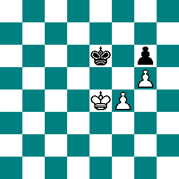
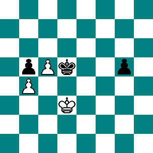
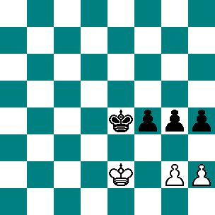
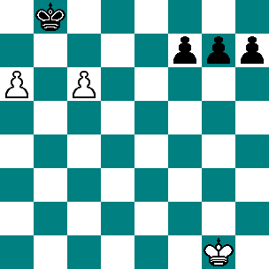
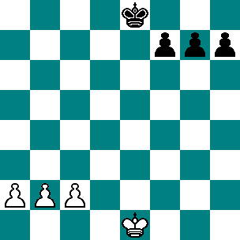

# S02 · 복수 폰과 왕의 경로

- 원저: *The Blue Book of Chess*, The John C. Winston Company 개정판 (1910), Chapter VII; Staunton 등의 저술을 바탕으로 편집
- 범위: 원서 242–247, 도해 34–38쪽
- 언어: 영어
- 수집일: 2026-10-31
- 출처: [원문](https://www.gutenberg.org/files/16377/16377-h/16377-h.htm#Pg_242)
- 권리 근거와 판본 설명: [출처 목록](../sources.md)

이 파일은 고전 영문 본문 발췌이며 한국어 번역본이 아닙니다. 원문 기보와 수순을 보존하고 줄바꿈·표·도해 경로를 Markdown에 맞게 바꾸었습니다. 원문 쪽수 표시는 생략했습니다. 수표의 `|`는 원문 열 구분입니다. 원저의 일반화나 분석을 현대 엔진으로 전수 검증한 자료는 아닙니다.

편집 주: 바로 앞의 Diagram 33은 절 제목과 달리 룩 교환으로 시작하여 이번 순수 폰 엔드게임 발췌에서 제외했습니다. 도해판의 33번도 제외하고 34–38번만 수록했습니다.

## 원문 배포 고지

This eBook is for the use of anyone anywhere in the United States and most other parts of the world at no cost and with almost no restrictions whatsoever. You may copy it, give it away or re-use it under the terms of the [Project Gutenberg License](../licenses/project-gutenberg.md) included with this eBook or online at [www.gutenberg.org](https://www.gutenberg.org). If you are not located in the United States, you’ll have to check the laws of the country where you are located before using this ebook.

## 영문 발췌

## KING AND TWO PAWNS AGAINST KING AND PAWN. Diagram 34.

First, suppose White moves:—

```text
 |
WHITE. | BLACK.
1. K. to Q's 4th. | 1. K. to Q's 3d.
2. K. to Q's 3d. | 2. K. to Q's 2d.
3. K. to K's 3d. | 3. K. to K's 2d.
4. K. to Q's 4th. | 4. K. to Q's 3d.
5. K. to K's 4th. | 5. K. to K's 3d.
And the game must be drawn. |
```

But suppose Black have to play:—

```text
 |
WHITE. | BLACK.
 | 1. K. to Q's 3d.
2. P. to K. B's 5th. | 2. K. to K's 2d.
3. P. to K. B's 6th. (ch.) | 3. K. to his 3d.
4. K. to Q's 4th. | 4. K. to Q's 3d.
5. P. to K. B's 7th. | 5. K. to his 2d.
6. K. to his 5th. | 6. K. takes P.
7. K. to Q's 6th. | 7. K. to B's sq.
8. K. to his 6th. | 8. K. to Kt's 2d.
9. K. to his 7th. | 9. K. to Kt's sq.
10. K. to B's 6th. | 10. K. to R's 2d.
11. K. to B's 7th. | 11. K. to R's sq.
12. K. takes P. | 12. K. to Kt's sq.
13. K. to B's 6th. | 13. K. to R's 2d.
14. K. to B's 7th. | 14. K. to R's sq.
15. K. to Kt's 6th. | 15. K. to Kt's sq.
16. K. to R's 6th. | 16. K. to R's sq.
17. P. to Kt's 6th. |
And wins. |
```

## KING AND TWO PAWNS AGAINST KING AND TWO PAWNS. Diagram 35.

```text
 |
WHITE. | BLACK.
1. K. to his 3d. | 1. K. to his 4th.
2. K. to B's 3d. | 2. K. to B's 4th.
3. K. to Kt's 3d. | 3. K. to K's 4th.
4. K. to Kt's 4th. | 4. K. to B's 3d.
5. K. to Kt's 3d. | 5. K. to K's 4th.
And the game is drawn. |
```

```text
 |
If Black move, he plays:— |
 | 1. K. to his 4th.
2. K. to his 3d. | 2. K. to Q's 4th.
(Were he to move K. to B's 4th , you would win by 3. K. to Q's 4th .) |
3. K. to B's 3d. | 3. K. to his 4th.
4. K. to Kt's 3d. | 4. K. to his 3d.
5. K. to Kt's 4th. | 5. K. to B's 3d.
```

And by continuing to play thus, Black may always draw the game.

## KING AND TWO PAWNS AGAINST KING AND THREE PAWNS. Diagram 36.

With or without the move Black wins.  First, with the move,—

```text
 |
WHITE. | BLACK.
 | 1. P. to K. Kt's 6th.
2. P. to R's 3d, or (A.) | 2. K. to Q's 5th.
3. K. to B's 3d. | 3. K. to his 4th.
4. K. to his 2d. | 4. K. to his 5th.
5. K. to B's sq. | 5. K. to Q's 6th.
6. K. to his sq. | 6. K. to K's 6th.
7. K. to B's sq. | 7. K. to Q's 7th.
8. K. to Kt's sq. | 8. K. to his 7th.
9. K. to R's sq. | 9. P. to B's 6th.
10. P. takes P. | 10. K. to B's 7th.
Winning. |
```

(A.)

```text
 |
2. P. takes P. | 2. R. P. takes P.
3. K. to B's sq. | 3. K. to his 6th.
4. K. to his sq. | 4. K. to Q's 6th.
5. K. to B's sq. | 5. K. to Q's 7th.
6. K. to Kt's sq. | 6. K. to his 7th.
7. K. to R's sq. | 7. P. to B's 6th.
And wins. |
```

Next, if White move first he must equally lose.

```text
 |
WHITE. | BLACK.
1. K. to B's 2d. | 1. P. to Kt's 6th. (ch.)
2. K. to Kt's sq. | 2. K. to his 6th.
3. K. to R's sq. | 3. P. to B's 6th.
4. P. takes B. P. | 4. K. to B's 7th, &c.
Winning. |
```

## KING AGAINST THREE PASSED PAWNS. Diagram 37.

```text
 |
WHITE. | BLACK.
 | 1. P. to B's 4th.
2. K. to Kt's 2d. | 2. P. to R's 4th.
3. K. to Kt's 3d. | 3. P. to Kt's 4th.
4. K. to Kt's 2d. | 4. P. to B's 5th.
5. K. to B's 3d. | 5. P. to R's 5th.
6. K. to Kt's 4th. |
```

And wins; because whatever Pawn is moved, the King takes it.

## KING AND THREE PASSED PAWNS AGAINST KING AND THREE PASSED PAWNS. Diagram 38.

```text
 |
WHITE. | BLACK.
 | 1. K. to Q's 2d.
2. P. to R's 4th. | 2. K. to Q. B's 3d.
3. P. to R's 5th. | 3. K. to Kt's 4th.
4. P. to Kt's 4th. | 4. P. to R's 4th.
5. P. to B's 4th. (ch.) | 5. K. to R's 3d.
6. P. to B's 5th. | 6. K. to Kt's 4th.
7. K. to B's 2d. | 7. P. to R's 5th.
8. K. to Kt's 2d. | 8. P. to Kt's 4th.
9. K. to R's 3d. | 9. P. to B's 4th.
10. K. to R's 2d. | 10. P. to B's 5th.
11. K. to Kt's 2d. | 11. P. to Kt's 5th.
12. K. to Kt's sq. | 12. P. to B's 6th.
13. K. to B's 2d. | 13. P. to R's 6th.
14. K. to Kt's 3d. | 14. Is obliged to move his King, and one of the White Pawns will Queen.
```

[[TABLE OF CONTENTS]](https://www.gutenberg.org/files/16377/16377-h/16377-h.htm#contents)

---

## 원문 도해 모음

도해판은 설명과 떨어져 인쇄되어 있어 이곳에 모았습니다.

### Diagram 34



### Diagram 35



### Diagram 36



### Diagram 37



### Diagram 38


